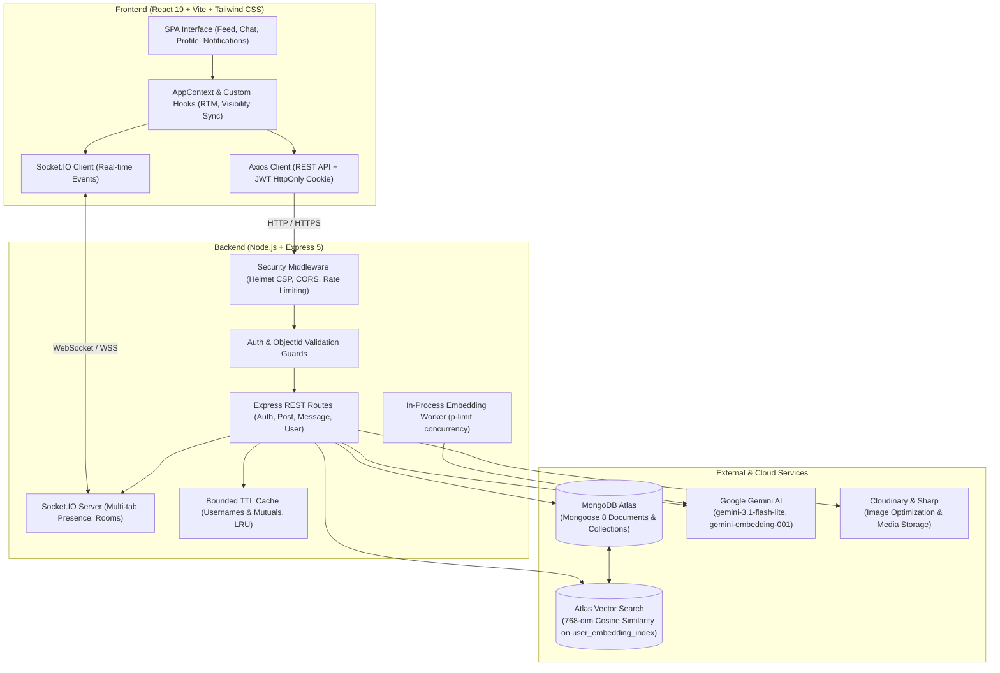

# Vybe

Vybe is a modern, full-stack social networking platform engineered with React 19, Node.js, Express 5, and MongoDB Atlas. It delivers instant 1-on-1 real-time messaging with Socket.IO, multi-tab presence synchronization, and interactive social feeds, alongside AI-assisted capabilities powered by Google Gemini (multimodal content moderation, automated image captioning, and 768-dimensional semantic user recommendations via MongoDB Atlas Vector Search).

**Live Demo**: [https://vybe-ymdg.onrender.com](https://vybe-ymdg.onrender.com)  
**Demo Account**:
- **Email**: `sahil26@gmail.com` | **Password**: `12345`
- **Username**: `sahil`
---

## Preview


---

## System Architecture



---

## Key Features

- **Semantic Recommendations (Atlas Vector Search)**: Suggested users are computed using MongoDB Atlas Vector Search (cosine similarity on 768-dimensional Gemini embeddings generated from user bios and recent post captions), with resilient fallback to mutual connection graphs.
- **Direct Messaging & Real-Time Sync**: Real-time 1-on-1 chat powered by Socket.IO with multi-tab presence tracking, tab visibility-aware read receipts (`readAt`), message editing, deletion, and message forwarding.
- **Fail-Closed AI Content Moderation**: Image uploads and captions pass through automated Google Gemini policy classifiers before persistence. Fails closed on policy violations or unconfigured keys in production.
- **AI Assist Tools**: One-click AI caption generation from image previews, automated accessibility alt-text generation, and background embedding generation.
- **Social Feed & Engagement**: Responsive post feed with media uploads, nested comments, like tracking, bookmark collections, and user profile management.
- **Security & Hygiene**: Cookie-based JWT authentication (`httpOnly`, `sameSite`, `secure`), rate limiting on sensitive routes, strict Helmet Content Security Policy, and sanitized error responses.

---

## Tech Stack

| Layer | Technologies |
|---|---|
| **Frontend** | React 19, Vite, Tailwind CSS, Radix UI Primitives, Lucide Icons, Sonner, Axios, Socket.IO Client |
| **Backend** | Node.js, Express 5, Socket.IO, Mongoose 8, Helmet, Express Rate Limit, Sharp, Multer |
| **Database & AI** | MongoDB Atlas, Atlas Vector Search, Google Gemini API (`gemini-3.1-flash-lite`, `gemini-embedding-001`) |
| **Cloud & Media** | Cloudinary, Render |

---

## Setup & Local Installation

### Prerequisites
- Node.js (v20 or higher recommended)
- A MongoDB Atlas cluster (M0 free tier supported)
- Cloudinary account credentials
- Google Gemini API key

### 1. Clone & Install Dependencies
```bash
git clone https://github.com/Sahil26singh/vybe-.git
cd vybe-

# Install root & backend dependencies
npm install

# Install frontend dependencies
npm install --prefix frontend
```

### 2. Configure Environment Variables
Copy `.env.example` to `.env`:
```bash
cp .env.example .env
```

| Variable | Description | Example / Default |
|---|---|---|
| `PORT` | Backend server port | `8000` |
| `NODE_ENV` | Environment mode (`development` or `production`) | `development` |
| `URL` | Frontend origin for CORS | `http://localhost:5173` |
| `MONGO_URI` | MongoDB Atlas connection string | `mongodb+srv://...` |
| `SECRET_KEY` | JWT signing secret | `your_secure_secret_key` |
| `CLOUD_NAME` | Cloudinary cloud name | `your_cloud_name` |
| `API_KEY` | Cloudinary API key | `your_api_key` |
| `API_SECRET` | Cloudinary API secret | `your_api_secret` |
| `GEMINI_API_KEY` | Google Gemini API key | `your_gemini_api_key` |
| `GEMINI_MODEL` | Gemini text & vision model | `gemini-3.1-flash-lite` |
| `GEMINI_EMBEDDING_MODEL` | Gemini embedding model | `gemini-embedding-001` |
| `VECTOR_INDEX_NAME` | Atlas Vector Search index name | `user_embedding_index` |
| `MODERATION_MODE` | Moderation fallback policy (`block` or `allow`) | `block` |

### 3. Create the Atlas Vector Search Index (Optional but Recommended)
In MongoDB Atlas:
1. Navigate to **Search & Vector Search** -> **Create Search Index**.
2. Choose **Atlas Vector Search (JSON Editor)**.
3. Target the `users` collection in your database.
4. Name the index `user_embedding_index` and supply the configuration from [`vector-index.json`](./vector-index.json):
```json
{
  "fields": [
    {
      "type": "vector",
      "path": "embedding",
      "numDimensions": 768,
      "similarity": "cosine"
    },
    {
      "type": "filter",
      "path": "embeddingModel"
    },
    {
      "type": "filter",
      "path": "embeddingStatus"
    }
  ]
}
```

### 4. Run Development Servers
```bash
# Terminal 1: Backend API
npm run dev

# Terminal 2: Frontend Client
npm run dev --prefix frontend
```
The client will start at `http://localhost:5173` and proxy/connect to API at `http://localhost:8000`.

### 5. Production Build & Execution (Local Render Simulation)
```bash
npm run build
npm start
```

---

## Maintenance Scripts

- **`node backend/scripts/mergeDuplicateConversations.js`**: Safe conversation cleanup utility. Runs in dry-run mode by default; add `--apply` to merge split legacy conversations and backfill unique `participantsKey` indexes.
- **`node backend/scripts/backfillEmbeddings.js`**: Evaluates all users, generates 768-dim vector embeddings, and stores status. Add `--apply` to write to the database.
- **`node backend/scripts/backup.js`**: Exports all MongoDB collections to timestamped JSON files in `backend/backups/`.
- **`node backend/scripts/test_concurrency.js`**: Concurrency regression test demonstrating E11000 duplicate race handling, atomic `$addToSet` merging, and single-document convergence.

---

## Known Limitations & Scaling Plan

This application was architected with clear boundaries to demonstrate modern full-stack capabilities. Below are the architectural tradeoffs made and the corresponding enterprise scaling path:

1. **Presence & Online Status**:
   - *Current*: Handled in-memory on the Node.js server using a `Map<userId, Set<socketId>>` and broadcast via Socket.IO.
   - *Scaling Plan*: Replace in-memory state with **Redis Pub/Sub** and an atomic presence set (`SET <userId>:presence <timestamp> EX 60`). Allows horizontal scaling across multiple load-balanced Node.js / Socket.IO instances with sticky sessions or a Redis adapter.

2. **Asynchronous Embedding Workers**:
   - *Current*: Profile text embeddings are generated asynchronously in-process with a `p-limit(3)` queue and debouncing timers.
   - *Scaling Plan*: Offload vector generation to a distributed task queue (e.g., **BullMQ + Redis** or AWS SQS). This isolates heavy external AI API latency and rate-limiting from the web server, enabling independent worker autoscaling and automatic retry policies with dead-letter queues.

3. **Schema Normalization (Likes & Messages as Arrays)**:
   - *Current*: Post likes (`[ObjectId]`) and conversation message IDs (`[ObjectId]`) are stored as embedded arrays within their parent documents for fast, single-document retrieval.
   - *Scaling Plan*: While optimal for small to medium scale, documents with viral interaction could approach MongoDB's 16MB document limit. Transition likes to an indexed `likes` collection with compound indexing `{ targetId: 1, userId: 1 }` and partition conversation messages into a dedicated `messages` collection with cursor-based windowing.

4. **Distributed Rate Limiting**:
   - *Current*: Route rate limiting uses in-memory sliding window counters (`express-rate-limit`).
   - *Scaling Plan*: Switch to `rate-limit-redis` so that rate-limit quotas and authentication attempt caps are shared across all cluster processes.

---

## License

MIT License. Engineered by [Sahil Singh](https://github.com/Sahil26singh).
